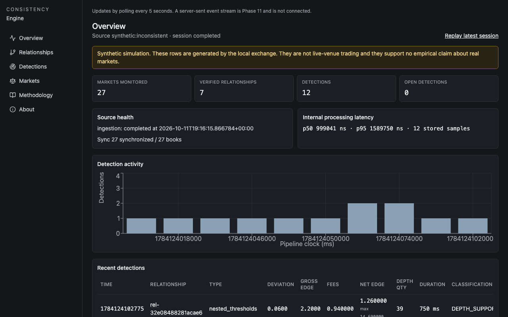
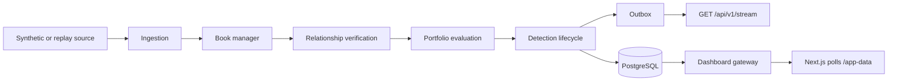

# Consistency Engine

Binary contracts that share a settlement constraint still trade in separate books. A
last trade or a YES bid is not the price of buying YES. The executable YES ask is one
minus the NO bid, and only the displayed size can be taken. Fees are charged per fill,
ceiled to $0.000001, then aligned to account precision, with a rebate of leftover
rounding. Several markets cannot be filled as one order. A book that looks profitable
on mids can fail those checks, and one that survives is a calculation on a snapshot,
not a fill.

The engine ingests a deterministic synthetic exchange or a recorded journal, rebuilds
each book, and evaluates a relationship only after every settlement check has passed.
Worst-case payoff is the minimum over admissible settlement states, minus the premium
to walk the book, minus fees. Each detection stores its certificate. The default
configuration does not call Kalshi. A synthetic detection tests this pipeline. It is
not a measurement of a live market.

This is an independent open-source project. It is not an official Kalshi product and
it is not endorsed by Kalshi. The delivery note for this build is
[docs/DELIVERY.md](docs/DELIVERY.md).



The image is the Compose dashboard at `http://127.0.0.1:3000` after `make demo`.
The yellow banner is the synthetic-simulation label. The click path, the stored
qualifying quote, and both recordings are in [docs/demo.md](docs/demo.md).
`ffprobe` reports the technical recording `docs/demo/demo.webm` at `44.760000`
seconds and `docs/demo/demo.gif` at `44.840000` seconds. The short cut
`docs/demo/demo-short.webm` is `24.440000` seconds and `docs/demo/demo-short.gif`
is `24.510000` seconds.

## Architecture



A book update enters through the ingestion runner. The book manager applies the snapshot
or delta and derives ask curves from the opposite bids. The detection engine evaluates
only relationships that list the updated market, and only when verification status is
`VERIFIED`. Portfolio evaluation prices a canonical basket. The lifecycle keeps one
detection per relationship and portfolio direction. PostgreSQL stores the journal, the
detection, its legs, its scenarios, and its certificate in one transaction, plus one
notification-outbox row.

The API tails that outbox. `GET /api/v1/stream` is the server-sent event stream. The
dashboard does not use it yet. The Next.js pages poll `/app-data`, which proxies an
internal gateway. The gateway reads the same persistence layer as `/api/v1`.

Details: [docs/architecture.md](docs/architecture.md).

## Mathematical model

Relationship types and the states they admit:

| Type | Admissible states |
|---|---|
| Implication (A ⇒ B) | (0,0), (0,1), (1,1). (1,0) is excluded |
| Nested thresholds | monotone chain, n + 1 states |
| Equivalent (A ⇔ B) | (0,0), (1,1) |
| Mutually exclusive | at most one YES |
| Exhaustive partition | exactly one YES |
| Disjoint intervals | at most one YES, or exactly one if coverage is proven |

Verification evidence is `PASS`, `FAIL`, or `UNKNOWN`. Any `FAIL` rejects the
relationship. Any remaining `UNKNOWN` leaves it in review. Only all-`PASS` is
`VERIFIED`. Only `VERIFIED` can confirm a detection. Adding admissible states weakens
the guarantee. Removing them requires a separate verified relationship that already
excludes those states. Exhaustiveness is not assumed.

Canonical baskets, per unit: implication is NO on the narrower contract plus YES on the
wider one (payoff 1); equivalence is both directions of YES/NO (payoff 1); an exclusive
group is a basket of NO (payoff n − 1); a proven exhaustive group also offers a basket
of YES (payoff 1).

Worst-case payoff at quantity Q is the minimum payoff over every admissible state, times
Q, minus the premium required to buy the legs at displayed depth, minus fees. The
certificate records the worst state. The full argument, including the quantity search
and the classification order, is [docs/mathematical-model.md](docs/mathematical-model.md).

## Order books, fees, and detections

The ask for a side is built only from the opposite bids: price `1 − bid`, same
quantity, cheapest first. Buying a size walks that curve level by level. Unfilled size
is reported. The engine does not invent liquidity. Decisions use the exact premium.
The volume-weighted average is informational.

The published fee formula, schedule dated 2026-07-07, is

```
taker fee = M_taker · 0.07   · C · P · (1 − P)
maker fee = M_maker · 0.0175 · C · P · (1 − P)
```

Each fill's model fee is ceiled to $0.000001. The balance change is then floored to
account precision: $0.0001 for a direct account, $0.01 for a non-direct account.
Unknown member class uses the coarser grid. Rounding leftovers accumulate per order
and can be rebated in whole precision steps, capped so the net fee is never negative.
The synthetic exchange uses a fictional schedule through the same rounding. A live fee
with an unknown series, member class, or FCM fee is `FEE_UNVERIFIED` and cannot be a
fee-adjusted candidate. Scanner evaluations take liquidity. A maker assumption is
marked and cannot be a candidate.

One detection is one continuous signal for a relationship and a portfolio direction:

| Status | Meaning |
|---|---|
| `OPEN` | First signal |
| `UPDATED` | Classification, reason, or a quoted figure changed, including a decrease. Maxima are kept separately from the current quote |
| `RESOLVED` | The edge disappeared on trusted, fresh data |
| `EXPIRED` | It can no longer be assessed: stale data, market not open, no asks, or the session ended |
| `INVALIDATED` | Inputs became untrusted: unsynchronized or interrupted books, or the relationship changed |

An unchanged quote does not emit another event.

## Synthetic exchange and replay

`DATA_SOURCE` defaults to `synthetic`. The bundled inconsistent preset is a fixed
recording (seed, relationships, and fee versions included in the session fingerprint).
Playback speed changes only the sleep between messages. It does not change the
fingerprint. The latest session for that fingerprint decides. A completed
session is not ingested again. A later failed or interrupted reseed is resumed
and does not open another id. `RESEED_SESSION=true` or
`python -m consistency_worker run --reseed` opens a new session when the latest
one already completed. The default is off.

`DATA_SOURCE=replay` reads a recorded journal. Opening a session stores
content-addressed market, relationship, and fee snapshots, and replay loads those
versions rather than whatever the reference tables say now.

The dashboard and `POST /api/v1/replay/sessions/{id}/start` each fork a viewer id.
Viewers do not share a cursor and do not write the canonical journal. Viewer state is
in the gateway process. See [Limitations](docs/limitations.md).

The Kalshi adapter in `packages/connectors` is a skeleton and is not activated.
`DATA_SOURCE=kalshi_authorized` is refused unless both `ENABLE_KALSHI_API` and
`KALSHI_AUTHORIZATION_CONFIRMED` are true. Both default to false. This repository does
not set them.

## Getting started

Requirements: Docker, uv, and Node.js 22. From the repository root:

```bash
make setup
npm install --prefix apps/web
make dev
```

`make setup` installs the Python workspace. The npm install is required; without
`apps/web/node_modules`, `make dev` exits 2. `make dev` starts PostgreSQL 16, applies
migrations, loads the synthetic session, and runs the maintenance process, the worker,
the dashboard gateway, and Next.js. The dashboard is `http://127.0.0.1:3000`. It polls.
The public stream is `GET /api/v1/stream` on the API process, which `make dev` does not
publish; the compose stack below runs that API.

The host database publishes `127.0.0.1:${POSTGRES_PORT:-5432}` only. If port
5432 is already in use, set `POSTGRES_PORT` and `DATABASE_URL` before `make dev`.
This machine's host-test database is on port 5433. Do not point that URL at a
different PostgreSQL on 5432. `make dev` binds Next.js to `127.0.0.1`.

The Compose stack uses its own volume and does not publish Postgres:

```bash
docker compose -p consistency-deploy up --build -d
```

The frontend binds `127.0.0.1:3000` only. API, gateway, and Postgres stay on the
compose networks. Stop that project with `docker compose -p consistency-deploy down`.
That command does not remove the host-test database. Worker health, reseed, and
retention are specified in [docs/deployment.md](docs/deployment.md).

`make demo` starts that Compose project if the dashboard is not already up, waits
for the completed synthetic session, and prints the detection id it read from
Postgres. The path is `http://127.0.0.1:3000/detections/<id>`.

## Tests

Python, with `DATABASE_URL` set to the host Postgres (port 5432, or 5433 when that
host database was started with `POSTGRES_PORT=5433`):

```bash
make lint
make typecheck
make test
```

`make lint` is `ruff check` and `ruff format --check`. `make typecheck` is mypy strict. `make test` is the full pytest
suite: unit, golden, property, replay, and integration. Integration tests need
PostgreSQL. They do not use SQLite.

Frontend, from `apps/web`:

```bash
npm run lint
npm run typecheck
npm test
npm run build
```

From the repository root, the audit check and its regressions:

```bash
node --test scripts/npm_audit_lib.test.mjs
node scripts/check_npm_audit.mjs
```

Playwright, two specs (`e2e/dashboard.spec.ts` and `e2e/disconnected.spec.ts`):

```bash
make e2e
```

`make e2e` starts the host database when `E2E_SKIP_COMPOSE` is unset. When that
database is already up:

```bash
E2E_SKIP_COMPOSE=1 POSTGRES_PORT=5433 bash scripts/e2e.sh
```

Set `WEB_PORT` if 3000 is taken.

Compose smoke builds the deployment images, starts a fresh database on an internal
network, waits for worker-written detections, calls `GET /api/v1/detections`, restarts
the worker and the API, and tears down only its own project:

```bash
bash scripts/compose_smoke.sh
```

Postgres is not published. The frontend for that run binds `127.0.0.1:18080` unless
`SMOKE_WEB_PORT` is set. GitHub Actions runs the same script.

## Benchmarks

Numbers below are copied from [docs/benchmarks.md](docs/benchmarks.md). They were not
remeasured for this file. Book-update throughput and `pricing.evaluate` latency are
not end-to-end detection latency.

Earlier single-process run, listener entries divided by worker wall time, including
session open:

| Markets | Msg/s | Detection p50 / p95 / p99 (ms) |
|---:|---:|---|
| 54 | 1310.33 | 0.3338 / 0.4797 / 0.5371 |
| 270 | 1093.72 | 0.3371 / 0.4849 / 0.5816 |
| 1026 | 658.20 | 0.3365 / 0.4873 / 0.5753 |
| 5022 | 313.48 | 0.3335 / 0.4884 / 0.5782 |

The 1000 msg/s goal was hit only on that run's 54- and 270-market rows. It was missed
on 1026 and 5022.

Later isolated repetitions. Steady-state median msg/s excludes the cold window and
session open. Detection columns are time inside `pricing.evaluate`:

| Markets | Steady median msg/s | Full-run median msg/s | Detection p50 / p95 / p99 (ms) |
|---:|---:|---:|---|
| 54 | 773 | 732.46 | 0.5752 / 0.8351 / 1.164 |
| 270 | 794 | 588.80 | 0.5849 / 0.8383 / 1.0014 |
| 1026 | 666 | 286.15 | 0.6758 / 1.1106 / 1.4523 |
| 5022 | 0 | 152.79 | 0.5646 / 0.8226 / 0.9403 |

Those steady-state medians miss 1000 msg/s. At 5022 markets the median 0.5 s window
completed no listener entries. The mean of those windows is 309.76 msg/s. Session-open
median at 5022 markets is 38.1022 s and is excluded from the steady median.

Inconsistency workload (seed 505, 27 markets, 12276 messages). Lifecycle counts on the
middle repetition: OPENED 12, UPDATED 120, EXPIRED 7, RESOLVED 5. Steady median
452 msg/s. Certificate serialization p50 0.6041 ms (n=420). Detection-commit p50
18.3789 ms (n=144). End-to-end, from the book update until that detection transaction
commits, p50 **2281.125 ms** (n=144, p95 6614.0593 ms). That figure includes outbox
queue wait.

## Security

The replay token is not sent to the browser. The Next server sets an httpOnly
capability cookie and attaches `X-Replay-Token` only on the hop to the gateway.
`/api/v1` requests are rate-limited. `X-Forwarded-For` is ignored unless
`TRUSTED_PROXY_COUNT` is at least 1 and the TCP peer is listed in `TRUSTED_PROXIES`.
The same rule applies to replay capability issuance. Stream clients resume with
`Last-Event-ID` set to an outbox id. A cursor at or below the retention floor
resynchronizes from the detection snapshot. The default configuration makes no Kalshi
network call.

Details: [docs/security.md](docs/security.md).

## Data sources

| Source | Role |
|---|---|
| Synthetic | Default. Deterministic generator and the bundled inconsistent recording |
| Replay | The same journal, played back with the reference versions recorded at session open |
| Kalshi adapter | Skeleton, not activated. Data methods raise before any network call. Both enable flags default to false |

## Limitations

Settlement rules that are not fully verified are not priced. Stale or skewed quotes are
rejected. Multi-market portfolios are not atomic. Displayed depth can vanish. Incomplete
relationships stay in review. Fees use the published formula; live series exceptions,
member class, and FCM fees are unverified unless every input is present. A market that
is not open expires the detection. There is no capital or position check. A
fee-adjusted candidate is not a realized profit. Synthetic output is not an empirical
finding about Kalshi. Replay viewer cursors are in memory. Two npm development
advisories remain allowlisted. End-to-end detection latency is the 2281.125 ms median
above, not the sub-millisecond pricing timer.

The same list, with the gates that implement it:
[docs/limitations.md](docs/limitations.md).

## Roadmap

Not in the current tree:

- The Kalshi adapter stays off unless `ENABLE_KALSHI_API` and
  `KALSHI_AUTHORIZATION_CONFIRMED` are both set. Using it would be a separate
  authorized read-only step.
- The dashboard polls `/app-data`. `GET /api/v1/stream` is implemented and is not
  what the pages subscribe to.
- A replay viewer cursor is stored in the gateway process. Another process does
  not see it.
- Moving the frontend to Tailwind 4 would remove the two allowlisted development
  advisories, `GHSA-vfj7-8cjw-p6xm` (braces) and `GHSA-rj75-hqrm-r3gf`
  (postcss-selector-parser). The production audit count is 0.

## Documentation

- [Architecture](docs/architecture.md)
- [Mathematical model](docs/mathematical-model.md)
- [API reference](docs/api-reference.md)
- [Deployment](docs/deployment.md)
- [Security](docs/security.md)
- [Benchmarks](docs/benchmarks.md)
- [Compliance](docs/compliance.md)
- [Limitations](docs/limitations.md)
- [Data contracts](docs/data-contracts.md)
- [Progress](PROGRESS.md)
- [Demonstration](docs/demo.md)
- [Delivery](docs/DELIVERY.md)
